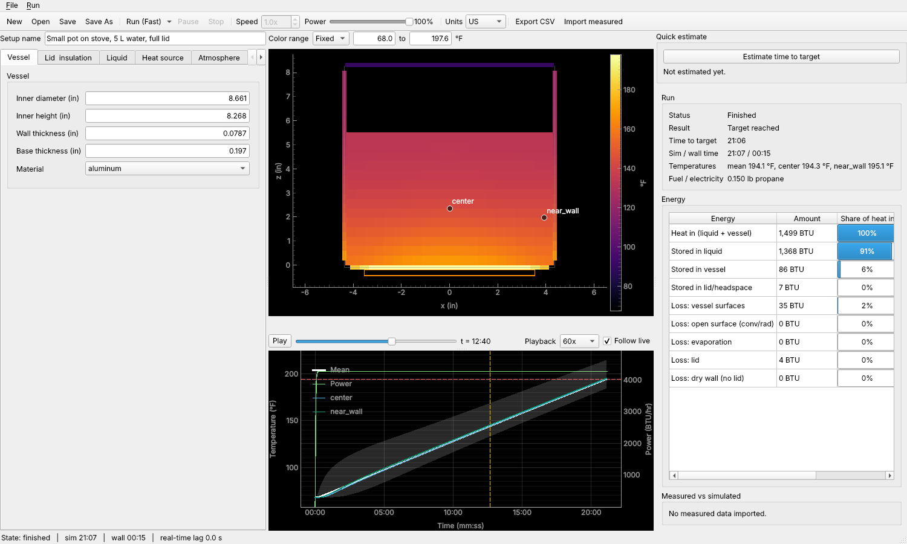

# ThermoSim

Thermal simulation of a heated vessel. Describe a pot or kettle, the liquid in it,
a propane burner or electric element, and the weather, and ThermoSim predicts how
long the liquid takes to reach a target temperature, how the heat spreads through
the liquid, where the energy goes, and how much fuel or electricity is used. It is
meant for tuning a brewing PID controller without boiling real water, and for
planning brews in different outdoor conditions. Results can be compared with
measured temperature logs.



## Install and launch

You need [uv](https://docs.astral.sh/uv/), which fetches Python and the libraries.

```
git clone https://github.com/jdchandler88/thermosim
cd thermosim
uv run thermosim gui
```

Other ways to run it:

```
uv run thermosim run src/thermosim/scenarios/small_pot_stove.toml   # no window
uv run thermosim examples                                          # list examples
uv tool install git+https://github.com/jdchandler88/thermosim      # install the program
```

On Windows, follow [packaging/windows/README.md](packaging/windows/README.md); it has
a double-click launcher (`packaging/windows/thermosim.bat`).

## Documentation

- [User guide](docs/user-guide.md): creating a setup, fast and real-time runs,
  reading the results, comparing with measured data.
- [Requirements](REQUIREMENTS.md): what the program is for and what it must do.
- [Implementation plan](docs/plan/README.md), [physics notes](docs/physics) and
  [validation](docs/validation.md): for developers.

## Development

```
uv sync --extra dev
uv run pytest -q
uv run ruff check && uv run ruff format --check && uv run mypy src
```

Set `QT_QPA_PLATFORM=offscreen` to run the GUI tests without a display.
