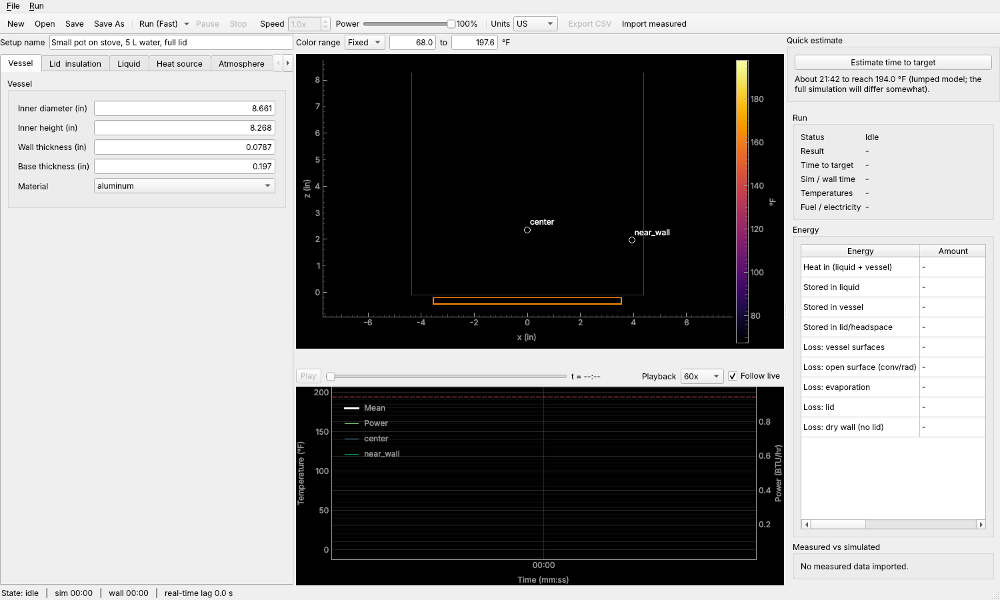
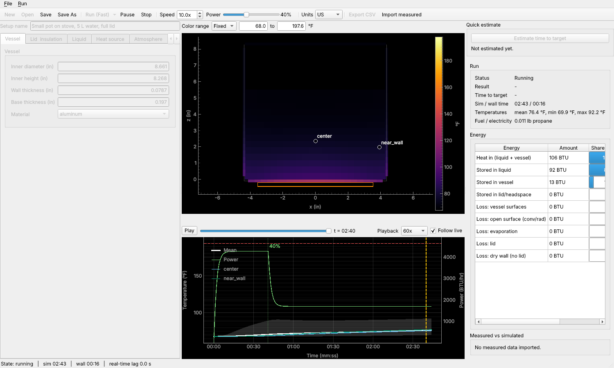
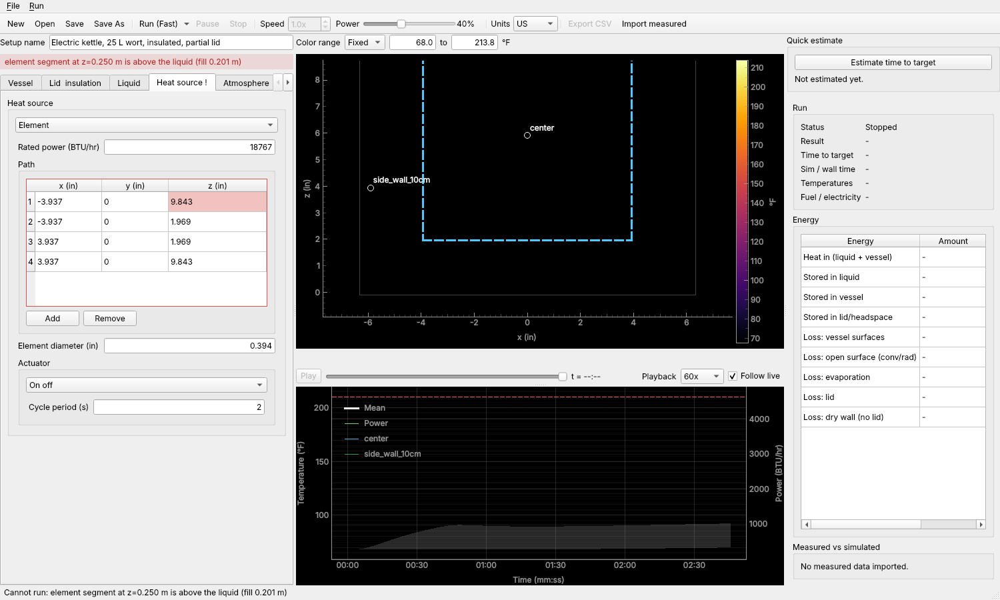
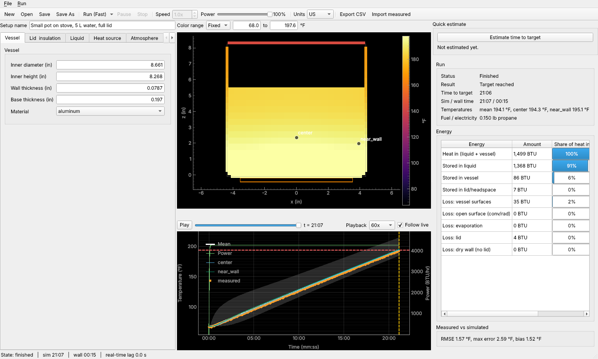

# ThermoSim user guide

ThermoSim predicts how a vessel of liquid heats up on a propane burner or with an
electric element: how long it takes to reach a target temperature, where the heat
goes, and how much fuel or electricity it uses. You describe the setup, run the
simulation, and look at the temperatures inside the liquid.

- Install and launch: see the [Windows instructions](../packaging/windows/README.md)
  (macOS and Linux: `uv run thermosim gui` in a clone of the repository).
- Requirements and design background: [REQUIREMENTS.md](../REQUIREMENTS.md).

The screenshots below were produced by the real simulator at a 10 mm cell size
(`python packaging/make_screenshots.py`).

## 1. The window



| Area | What it is |
|---|---|
| Left | The **setup editor**: tabs for vessel, lid and insulation, liquid, heat source, atmosphere, probes and target, and simulation settings. |
| Centre top | The **slice view**: temperature on a vertical cut through the middle of the vessel, with the probes marked. |
| Scrubber | Drag to look at any moment of the run; *Play* replays it at 10x to 1000x. |
| Centre bottom | The **chart**: probe and mean temperatures, the min-max band, the target (dashed red line), the heat source power (green, right axis) and any measured data. |
| Right | **Quick estimate**, then the **run summary** and the **energy breakdown**, then the **comparison** with measured data. |
| Toolbar | New, Open, Save, Run, Pause, Stop, real-time speed and power, the **Units** switch, Export CSV, Import measured. |

**Units.** US customary units are the default; switch to metric with the *Units*
box in the toolbar. Only the display changes: a setup is always stored in SI units, so
you can switch at any time without changing the setup. Numbers in the editor are shown
rounded (for example 8.661 in); the exact value is kept until you type a new one.

## 2. Creating a setup

Start from *File > Examples* (small pot on a stove, 40 L propane kettle, insulated
electric kettle) or *New*, and change what you need. Every field has a tooltip.
Invalid entries are outlined in red, and the message appears above the tabs; *Run* is
disabled until the setup is valid. Save your setup with *Save* (a `.toml` file you can
also edit in a text editor).

### What each setting means physically

**Vessel.** A cylinder with a flat base. *Inner diameter* and *inner height* set how
much liquid it holds and how much surface area loses heat. *Wall* and *base thickness*
and the *material* set the metal's heat capacity (it must be heated too) and how well
heat spreads sideways. Aluminum and copper conduct well; stainless steel conducts
poorly, so the base heats unevenly. A custom material needs density, specific heat,
conductivity and emissivity.

**Lid and insulation.** *Lid*: none, full, or partial (a covered fraction). A lid
mainly stops evaporation and open-surface radiation, which are the big losses near
boiling. *Insulation* is an optional layer on the side, base and/or lid: thicker or
lower conductivity means less loss through the wall.

**Liquid.** Give either the *volume* or the *fill height* (setting one clears the
other), the *initial temperature*, and the *specific gravity* (water is 1.000, wort is
about 1.040 to 1.080). Specific gravity changes the density and heat capacity of the
liquid.

**Heat source.**
- *Propane burner*: *rated power* (the gross fuel energy rate), *efficiency* (the
  share of that which reaches the vessel), and the *footprint* on the base, a disk or
  a ring, with its diameters. A small footprint concentrates heat in the middle of the
  base. The actuator is either an on/off cycle (the command sets the on-share of each
  cycle of the given *cycle period*) or a modulating valve (a *minimum fraction* it can
  hold, and a *response time*).
- *Electric element*: *rated power*, the *path* (x, y, z points of the element's
  centre line, origin at the centre of the inner base, z up) and its *diameter*. The
  whole path must be inside the liquid, or a run is refused and the offending point
  is highlighted (see section 7).

**Atmosphere.** *Ambient temperature*, *wind speed* (forced convection on the outside:
a breeze can double the side-wall loss), *relative humidity* and *altitude* (air
pressure sets the boiling point and the evaporation rate).

**Probes and target.** Probes are named points in the liquid that you can read like a
thermometer; they appear on the slice and the chart. The *target* is a temperature at
a chosen probe (or the volume-weighted *mean*); the run stops when it is reached.
*Power schedule*: the requested power as a fraction of the rated power, as steps over
time (the first step is at t = 0). It is used by fast runs; in real-time runs you set
the power with the slider instead.

**Simulation.**
- *Cell size*: the liquid is split into cubes of this size. Smaller is more accurate
  and slower; 5 mm is the standard, 10 mm is a quick preview, and the run time rises
  steeply (about 8 times more cells when halving the size, and smaller time steps too).
- *Maximum simulated time*: the run stops here if the target is never reached.
- *Run mode* and *real-time speed*: see sections 3 and 4.
- *Sample interval* (chart points) and *snapshot interval* (slice frames): how often
  results are recorded.
- *Plateau window / rate*: the run also stops, with "levelled off below target", when
  the temperature rises more slowly than this rate over the window (for example a boil
  that never reaches your target).
- *Coefficient refresh interval*: how often material properties and heat-transfer
  coefficients are updated as temperatures change.

**Model.** The *effective conductivity factor* is a calibration knob: it multiplies the
liquid's effective conductivity (which includes the mixing effect of convection). Use
1 unless you are tuning against measurements.

## 3. Quick estimate

Press **Estimate time to target** (right-hand column) for an answer in a fraction of a
second, using a simple one-temperature model of the whole vessel. It is good for a
first check of a setup (the example above: about 21:42 against 21:06 from the full
simulation) but it knows nothing about temperature differences inside the liquid.

## 4. Running in fast mode

Choose **Run (Fast)**. Before the run starts, ThermoSim checks the setup in the
background behind a small dialog (you can cancel it):

- it builds the vessel and heat source, and reports a problem next to the field that
  causes it (section 7);
- the very first run after installation first compiles the solver: **"Preparing solver
  (first run only)..."**; later runs skip this;
- it measures the solver speed and estimates the run time. If the estimate is over 10
  minutes you are offered the 10 mm preview cell size, to run anyway, or to cancel.

The run then goes as fast as it can, following the power schedule, and stops when the
target is reached, the temperature levels off, the maximum time is reached, or you
press **Stop**.


## 5. Running in real time

Choose **Run (Real-time)** to watch the run unfold at a speed you pick (*Speed*, 10x
means 10 simulated seconds per second) and to control the heat source live:

- the **Power** slider changes the requested power at once: a dotted marker with the new
  setting appears on the chart immediately, and the delivered power follows within a
  sample or two;
- the **Speed** box changes the speed; if the computer cannot keep up, the status bar
  shows the real-time lag;
- keyboard shortcuts (when you are not typing in a field): **Space** pause/resume,
  **Up/Down** power plus or minus 5 %, **+** and **-** speed.



While a run is going, the setup cannot be edited. *Pause* freezes it; *Stop* ends it
and keeps what has been simulated so far.

## 6. Reading the outputs

- **Slice view.** Colours are temperature; *Color range* is fixed (initial to a little
  above the target) or automatic. Drag the scrubber, or press *Play*, to move through
  time. While a run is live the view follows it; moving the scrubber stops following
  (untick/tick *Follow live*).
- **Chart.** The white line is the mean liquid temperature, the grey band the coldest
  to warmest cell, coloured lines the probes. The gap between a base probe and the
  mean shows how much stratification you have. The yellow dashed line is the time
  shown in the slice.
- **Run summary.** Status, result (target reached / levelled off / maximum time /
  stopped), the **time to target**, simulated and wall-clock time, the final
  temperatures and the fuel (US: pounds of propane) or electricity used.
- **Energy.** Where the heat went: how much stayed in the liquid, in the vessel
  and lid, and the losses through the vessel surfaces, from the open surface (convection
  and radiation), by evaporation, through the lid, and from dry walls above the liquid.
  The *share* bars are relative to the heat delivered. A big *stored in vessel* share
  means a heavy vessel for the liquid it holds; big *loss* shares show where
  insulation or a lid would help.
- **Saving.** *File > Save run...* writes a folder with the summary, time series,
  slice snapshots and the setup used. *File > Open run...* loads one for playback (no
  simulation needed). If you close, start a new run or open another setup while a
  finished run is unsaved, ThermoSim asks first. *Export CSV* writes the time series as a
  spreadsheet file (temperatures, powers and energies in the displayed units; the fuel
  column is always in kg and electricity in kWh, and the CSV inside a saved run folder
  is always metric).

## 7. When something is wrong

Entries that are not valid on their own (a letter in a number field, a negative size)
are caught as you type. Problems that only show up when the vessel is built are caught
when you press *Run*, and shown in the red banner and on the field:



Fix the highlighted field (here, a fill height lower than the element's legs, or move the
element) and run again. Relationships between fields (a probe above the liquid, a lid
insulation without a lid) are reported one at a time: fix one and the next may appear.

## 8. Importing measured data and comparing

Use **Import measured** (toolbar or *File*) to overlay a thermometer log from a CSV
file. A dialog shows the first rows and lets you pick the time and temperature columns
and their units (time in seconds or minutes, temperature in C, F or K); clock times
such as `14:03:20` are understood. The data appears as orange points on the chart.

After a run, the **Measured vs simulated** box reports, for the target probe (or the
mean), the root-mean-square error, the maximum error, the bias (positive when the
simulation runs hot), and the time to target in both. If they differ systematically,
try the *effective conductivity factor*, the burner *efficiency*, the *wind speed*
and the *lid* settings first.



The same comparison is available without the GUI:
`thermosim compare RUN_DIR measured.csv`.

## 9. Command line

```
thermosim gui [setup.toml]            open the window
thermosim run setup.toml --out DIR    run without the window; prints the summary
thermosim validate setup.toml         check a setup and estimate memory and run time
thermosim examples [--write DIR]      list or copy the example setups
thermosim compare RUN_DIR data.csv    compare a saved run with measured data
```

`thermosim gui --fake` uses synthetic data instead of the simulator (for developers).
